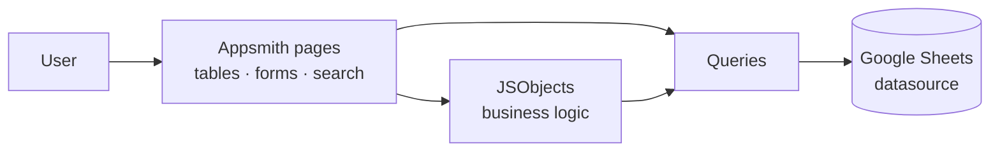

# OpsPulse Dashboard

**A modular operations dashboard for teams:** manage employees, projects and project assignments from one interface. It uses Google Sheets as a live backend.

Built with [Appsmith](https://github.com/appsmithorg/appsmith) in July 2025.

▶️ **[Open the live app](https://grapes.appsmith.com/applications/6864ba0cf7f09e3ff30ccd1e/pages/6864ba0cf7f09e3ff30ccd21)**

| | |
|---|---|
|  |  |
|  |  |

## Modules
| Page | What it does | Queries |
|---|---|---|
| **Employee Management** | Add, search and delete employees (ID, name, email, role, status, joining date) | `get_all_employees`, `add_employee`, `delete_employee` + `JSObject1.deleteEmployee` |
| **Project Management** | Create and track projects (dates, status, total hours, feedback) | `get_all_projects`, `add_project`, `delete_project` |
| **Employee Project Assignment** | Searchable view of who is assigned to what | `get_all_assignments` |
| **Admin Dashboard** | Combined view of employees, projects and assignments, with project feedback updates | `get_all_*`, `update_project_feedback` |

## Architecture


## Repository layout
This is an Appsmith Git-sync export:
```
application.json, metadata.json, theme.json   # app definition and theme
datasources/OpsPulse Datasource.json         # Google Sheets plugin (credentials are not exported)
pages/<Page>/widgets/*.json                  # UI widgets
pages/<Page>/queries/*/metadata.json         # Sheets queries
pages/<Page>/jsobjects/*                     # JavaScript logic
```

## Run your own copy
1. In Appsmith, choose **Create new → Import → Import from Git repository** and point it at this repo.
2. Reconnect the **OpsPulse Datasource** to your own Google Sheet, with Employees, Projects and Assignments tabs.
3. Deploy.

---
By [Akshat Verma](https://github.com/AKSHATv26)
